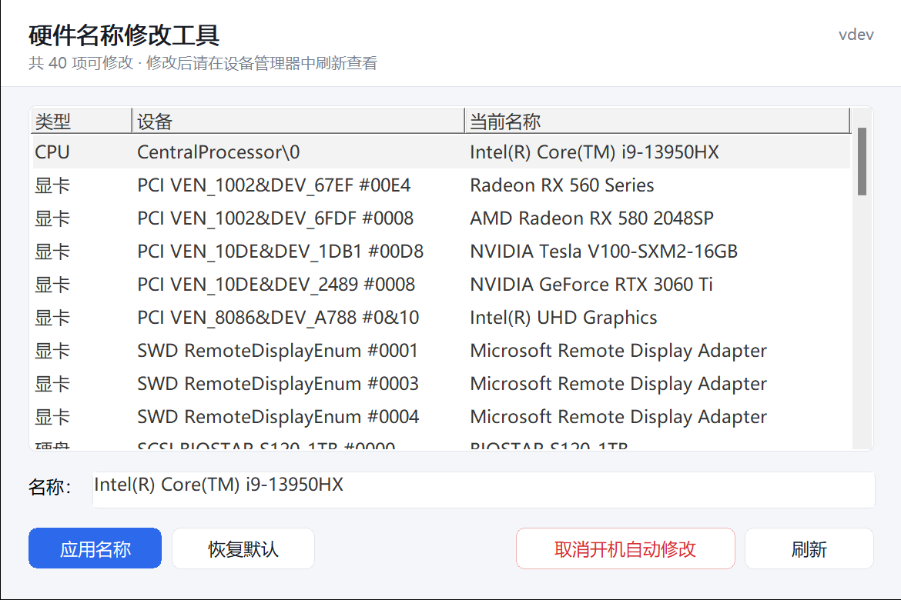

# Windows 硬件名称修改工具 HwName
## Windows Hardware Name Modifier

## 工具介绍
本工具可以修改 Windows 上硬件显示的名称，最初用于让 ES/魔改 CPU 显示正常型号而非 `Intel 0000`，现在支持 CPU、显卡、硬盘、声卡、显示器。

支持在虚拟机中使用，可以让虚拟机内的 CPU / GPU 不再显示为 VMware、QEMU 等型号（只是改显示名称，不做去虚拟化）。

支持临时修改，也支持开机免 UAC 自动修改。程序使用 **Go** 编写，单文件运行，无需安装运行库。



## 支持修改的范围

| 类别 | 修改位置 | 能看到效果的界面 |
| --- | --- | --- |
| CPU | `HARDWARE\DESCRIPTION\System\CentralProcessor\0\ProcessorNameString`<br>`SYSTEM\ControlSet001\Enum\ACPI\GenuineIntel*\*\FriendlyName` | 任务管理器、设备管理器、系统信息 |
| 显卡 | `SYSTEM\CurrentControlSet\Enum\PCI\<设备>\<实例>\FriendlyName`<br>`SYSTEM\CurrentControlSet\Control\Class\{4d36e968-…}\<nnnn>\DriverDesc` | 设备管理器、WMI（`Win32_VideoController`）、部分监控软件 |
| 硬盘 | `...\Enum\SCSI\<设备>\<实例>\FriendlyName` | 设备管理器（多个硬盘/虚拟盘分别列出） |
| 声卡 | `...\Enum\HDAUDIO\|PCI\<设备>\<实例>\FriendlyName` | 设备管理器 |
| 显示器 | `...\Enum\DISPLAY\<设备>\<实例>\FriendlyName` | 设备管理器 |

界面为一个设备列表：CPU 固定在首行，其余按 显卡 / 硬盘 / 声卡 / 显示器 排列，**同一型号的多个设备（比如两张显卡、三块硬盘）会逐条列出，可以分别改名**。

- **应用名称**：立即写入注册表，并把记录（含原始名称）保存到 `%APPDATA%\HwName.json`
- **恢复默认**：按记录还原原始名称（删除或写回 `FriendlyName` / `DriverDesc`）
- **设置开机自动修改**：把程序复制到 `%APPDATA%\HwName.exe`，通过 `NssmUI.exe` 注册为开机服务 `HwName`，开机时读取配置文件逐个应用；再点一次即取消（显示为红色文字）
- 名称修改后，设备管理器可点“扫描检测硬件改动”或重启系统查看；任务管理器需要重启才能看到 CPU 名称变化

## 关于 CPU-Z / GPU-Z 等工具
**这类软件显示的型号无法通过本工具修改**，原因是它们不走注册表：

| 软件 | 型号来源 | 能否修改 |
| --- | --- | --- |
| 任务管理器 / 设备管理器 / 系统信息 | 注册表 | ✅ 可以 |
| CPU-Z | CPUID 指令返回的品牌字符串（MSR `0x80000002`~`0x80000004`） | ❌ 需要内核驱动写 MSR 或虚拟机屏蔽 CPUID |
| GPU-Z | PCI 配置空间的 VendorID/DeviceID/SubsystemID + 显卡 BIOS + 自带数据库 | ❌ 只能改 VBIOS 或从内核层拦截 PCI 访问 |
| AIDA64 / HWiNFO（部分项） | 同上（CPU 走 CPUID，显卡走 PCI/驱动） | ❌ |

也就是说，注册表改名只能骗过“读注册表”的界面；绕过 Windows API 直接读硬件的软件，必须在 ring0（内核驱动/虚拟化）层面拦截，风险很高（需要签名驱动、可能触发反作弊/蓝屏，且 Windows 更新后易失效），本工具不实现这部分。

## 使用说明
- `HwName.exe` 需要与 `NssmUI.exe` 放在同一目录下，`NssmUI.exe` 会被自动复制到 `%APPDATA%` 缓存
- 修改 `HARDWARE` / `Enum` 注册表需要管理员权限，程序会自行申请（UAC）
- 服务模式的执行结果记录在 `%APPDATA%\HwName.log`
- 服务启动参数：`HwName.exe server`（读取 `%APPDATA%\HwName.json`）；兼容旧参数 `HwName.exe server "CPU`名称"`（空格用 `` ` `` 表示）

## 从源码构建
需要 Go 1.27 或更高版本，且只能在 Windows 上编译：

```powershell
# 普通构建（程序运行时自动申请管理员权限）
go build -trimpath -ldflags "-s -w -H windowsgui" -o dist/HwName.exe .

# 附带图标和 UAC 清单（可选，需要 rsrc）
go install github.com/akavel/rsrc@latest
rsrc -manifest app.manifest -ico HwName.ico -arch amd64 -o rsrc_windows_amd64.syso
go build -trimpath -ldflags "-s -w -H windowsgui -X main.buildVersion=1.0.0" -o dist/HwName.exe .
```

运行测试：`go test ./...`（界面冒烟测试需 `HWN_TEST_GUI=1`）

## 自动发布
推送代码到 `main` 分支后，GitHub Actions（`.github/workflows/build-beta.yml`）会自动：

1. `go vet` + `go test`
2. 编译 `HwName.exe`，打包 `HwName.exe` + `NssmUI.exe` + 说明文档为 `HwName-beta.zip`
3. 覆盖发布到 `beta` 预发布（Prerelease），版本号格式 `yyyyMMdd-<短提交>`

## 免责声明
 - 本工具仅用于自用 PC 修改 ES CPU / 硬件的显示名称
 - 不得用于任何商业行为或者欺骗性质的修改
 - 本作者不承担任何因修改带来的纠纷或后果
